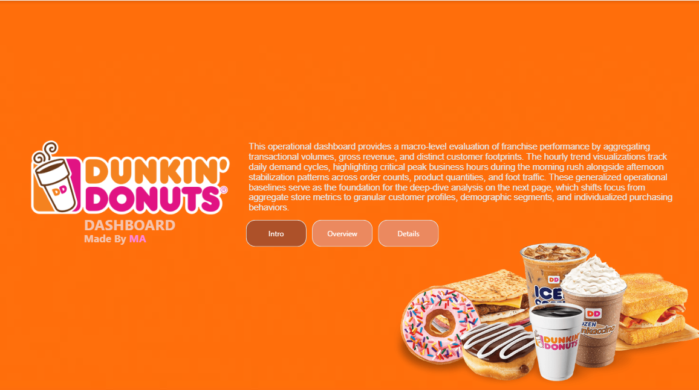
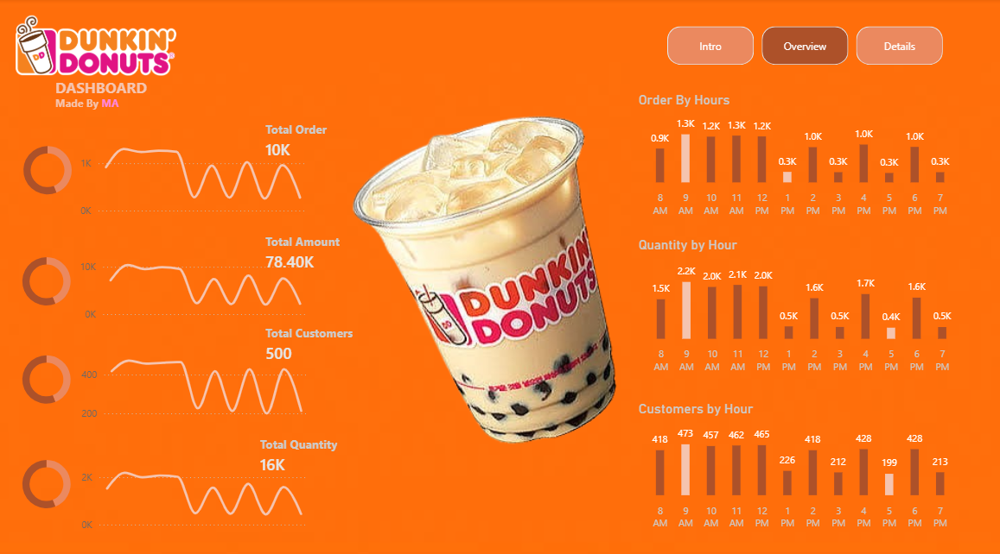
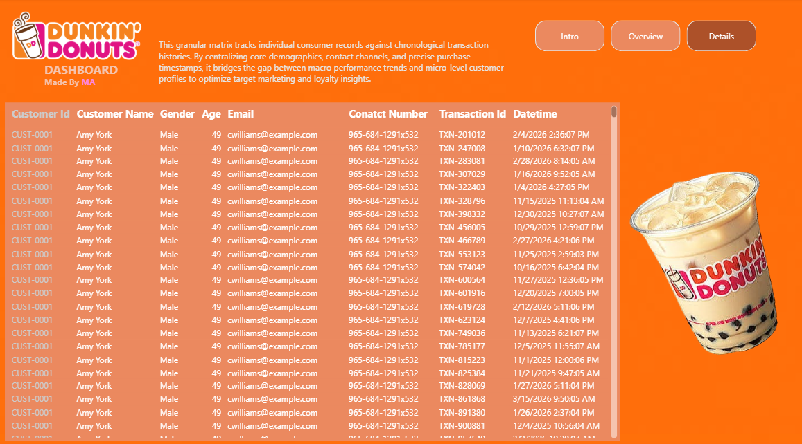

# Dunkin' Donuts Operational & Sales Analytics Dashboard

An interactive, vibrant brand-themed **Dunkin' Donuts Data Dashboard** built using **Power BI**. This project transforms transactional retail logs into powerful operational insights, bridging macro-level performance trends with granular consumer profiles to optimize target marketing and store efficiency.

---

## 🚀 Live Dashboard Preview

### 🏠 Introduction Page
<p align="center">
  
</p>

### 📊 System Views Breakdown
<p align="center">
  
  
</p>

---

## 📊 Key Features & Interactive Views

The analytics application uses an intuitive top navigation bar with custom bookmark buttons (**Intro, Overview, Details**) to switch between high-level operational metrics and raw transactional data:

* **Brand-Aligned UI Design:** Developed with Dunkin' Donuts' signature color scheme, custom typography states, and integrated product iconography for a cohesive presentation.
* **High-Level Store KPIs:** Instantly maps out absolute performance markers:
  * **Total Orders:** 10K
  * **Total Gross Revenue:** $78.40K
  * **Total Distinct Customers:** 500
  * **Total Quantity Sold:** 16K
* **Hourly Trend Visualizations:** Mini line sparklines paired with historical hourly bar charts to reveal peak morning rush intervals versus afternoon stabilization cycles across order counts, product quantities, and physical foot traffic.
* **Granular Customer Matrix:** A dedicated deep-dive data grid tracking specific consumer demographics, contact points, exact transactional timestamps, and individualized purchasing habits.

---

## 🧮 Tech Stack & Methodology

* **Business Intelligence Tool:** Power BI Desktop
* **Data Transformation:** Power Query (ETL pipeline handling schema cleaning, date/time parsing, and profile type casting)
* **Underlying Datasets:** Structured relational inputs including `customers.csv` and `items.csv`
* **Interactivity:** Context-driven bookmarks, visual tooltips, and state-based page navigation slicers.

---

## ⚙️ How to View the Project

1. **Clone the Repository:**
   ```bash
   git clone [https://github.com/M-Awad-27/Dunkins-s-Interactive-Dashboard.git](https://github.com/M-Awad-27/Dunkins-s-Interactive-Dashboard.git)
2.**Open in Power BI:**
      Ensure you have Power BI Desktop installed.
Open the Dunkins Dashboard.pbix file included in this repository.

3.**Explore the Insights:**
                     Click through the Intro, Overview, and Details navigation tabs at the top right of the application layout to dynamically slice the operational data.
## 🤝 Contributing
Feedback, issues, and aesthetic enhancement requests are always welcome! Feel free to open an issue or submit a pull request.

## 📝 License
This project is open-source and available under the MIT License.
